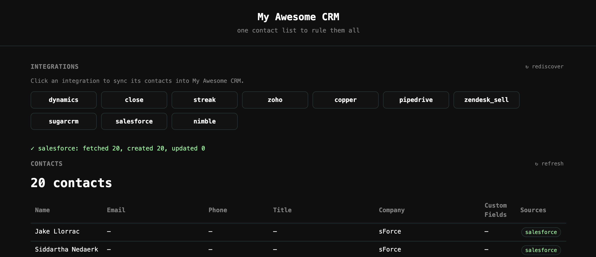

<p align="center">
  
</p>

# My Awesome CRM

Pulls contacts from several CRM providers into one generic store behind a small API.

## Features

- **Auto-discovered integrations**: a folder under `src/integrations/<provider>/` that exports `fetch` is picked up with no registry or config.
- **Generic storage**: each row has a `data_type` (e.g. `"contact"`), the `source` integration, and a free-form JSON `data` payload.
- **Idempotent re-syncs**: rows are upserted on `(source, data_type, external_id)`. Nothing is ever deleted, and syncing unchanged data is a no-op.
- **Read-back callback**: `fetch` receives a callback that returns every stored row of a `data_type`.
- **Web UI**: the root URL covers discovery, ingestion and the record list.
- **Records API**: paginated, filterable by `data_type`.

Records are stored verbatim, with no cross-provider deduplication. A record without an `external_id` cannot be matched, so it is always inserted.

## Supported CRMs

Salesforce, Dynamics365, Pipedrive, Zoho, Copper, Close, Streak, Zendesk Sell, SugarCRM, Nimble, HubSpot, Attio.

An integration only has to export a `fetch(get_stored)` callable from `src/integrations/<provider>/__init__.py`:

```python
def fetch(get_stored):
    existing = get_stored("contact")   # every stored row of this data_type
    ...                                # call the provider
    return [{"data_type": "contact", "data": {...}}]
```

The host stores each `data` object verbatim under its `data_type`.

## Integrations are built with \*\*\*plain

Each provider is a `.plain` module under `plain/` (e.g. `plain/salesforce.plain`). The renderer generates the plug-in into `src/integrations/<provider>/`. The specs are the source of truth: change an integration by editing its spec and re-rendering, never by editing the generated code.

### Rendering a spec

Prerequisites: the `codeplain` CLI on your `PATH` and `CODEPLAIN_API_KEY` exported.

```bash
cd plain
codeplain hubspot.plain
```

- `--dry-run` previews a render without generating code.
- On Windows, use PowerShell and add `--config-name config.pwsh.yaml` to use the PowerShell test scripts.

## Quickstart

```bash
./scripts/start.sh        # macOS / Linux
.\scripts\start.ps1       # Windows (PowerShell)
```

The script is idempotent. It checks for Python 3.12+ (offering to install it), creates `.venv`, installs `requirements.txt` when needed, and starts the server on `CRM_PORT`. On Windows you may need `powershell -ExecutionPolicy Bypass -File .\scripts\start.ps1`.

Manual setup:

```bash
python -m venv .venv && source .venv/bin/activate
pip install -r requirements.txt
uvicorn src.main:app --reload
```

- http://localhost:8000/ is the web UI.
- http://localhost:8000/docs is the Swagger UI.

The server is unauthenticated. The only credentials are the per-provider ones each integration reads from the environment (e.g. `SALESFORCE_CLIENT_ID`, `SALESFORCE_CLIENT_SECRET`).

### Configuration

| Variable | Default | Purpose |
|---|---|---|
| `CRM_PORT` | `8000` | Port to serve on. |
| `CRM_DB_PATH` | `crm.db` | SQLite file location. |

## Usage

```bash
# List discovered integrations
curl -X POST localhost:8000/ingest/discover

# Run an integration
curl localhost:8000/ingest/salesforce
# {"integration":"salesforce","data_types":{"contact":42},"fetched":42,"stored":42,"replaced":0,"unchanged":0}

# Browse records, optionally filtered by data_type
curl "localhost:8000/records?limit=10"
curl "localhost:8000/records?data_type=contact&limit=10"
```

## Layout

```
src/
├── main.py            # FastAPI app and web UI route
├── config.py          # settings
├── db.py              # engine and sessions
├── static/            # single-page web UI
├── api/               # health, records, ingest routes
├── services/ingest.py # discovery and orchestration
├── models/            # Record table and API schemas
├── repositories/      # data access
└── integrations/      # one folder per provider
```

## Tests

```bash
pytest
```

## Storage

One table, `Record`:

| Column | Holds |
|---|---|
| `id` | Primary key. |
| `data_type` | Kind of record, e.g. `"contact"`. |
| `source` | Integration that produced the row. |
| `data` | The record, as JSON. |
| `created_at` / `updated_at` | Timestamps. |

When an integration runs, the host calls `fetch(get_stored)` and upserts each returned record on `(source, data_type, external_id)`:

- No match: inserted (`stored`).
- Match with changed data: updated in place (`replaced`).
- Match with identical data: untouched (`unchanged`).

## Built with

FastAPI, SQLModel, SQLite, JSON logging.
